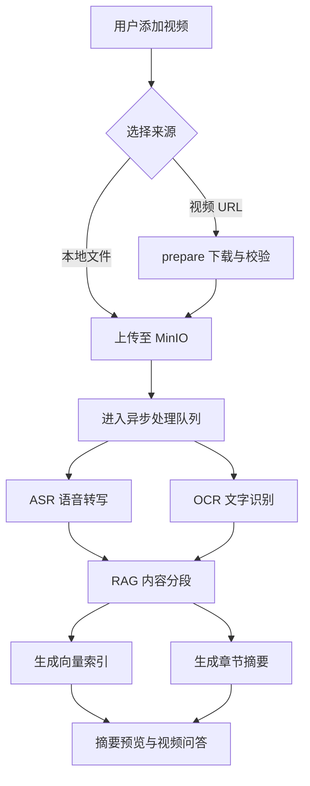

# ReaderGo

ReaderGo 是一个面向长视频内容的 AI 理解与问答系统。用户上传视频后，系统会异步完成语音转写、画面文字识别、内容分段、向量索引和章节摘要，并支持基于视频原始内容进行可追溯的智能问答。

## 技术栈

| 分类 | 技术 |
| --- | --- |
| 前端 | Vue 3、Vite |
| 后端 | Go、Gin、GORM、JWT |
| 数据库 | PostgreSQL、pgvector |
| 消息队列 | RabbitMQ、Transactional Outbox |
| 对象存储 | MinIO（S3 兼容） |
| AI 与媒体处理 | OpenAI 兼容接口、LLM、Embedding、FFmpeg |
| 缓存 | Redis |

## 项目核心

1. **可靠的大文件上传**：视频分片并发直传 MinIO，支持主动暂停、弱网恢复和页面刷新后续传，只重新上传 MinIO 中缺失的分片。
2. **上传去重与限流**：主要基于文件 SHA-256 实现多级上传去重，并通过 Redis Lua 令牌桶限制上传任务的突发创建。
3. **异步任务流水线**：通过 Outbox、RabbitMQ 和 Worker 解耦耗时任务，支持重试、死信处理及暂停恢复。
4. **多模态视频理解**：结合 ASR 语音转写与 OCR 画面文字识别，按时间轴融合生成分段内容和章节摘要。
5. **智能意图识别**：自动判断用户问题类型，并选择快捷回复、通用问答或视频内容检索等合适的回答路径。
6. **多路 RAG 检索**：融合向量检索和 BM25，提升视频问答的相关性与可追溯性。

## RAG 检索测评

项目使用 15 个真实视频、120 道 AI 辅助标注问题作为调参集，并使用另外 10 个真实视频、80 道 AI 辅助标注问题作为正式评测集（视频平均时长40分钟左右）。问题集通过窗口 ID 标注答案证据，并支持多证据点和等价答案窗口。

最终采用 Dense Vector 与字段加权 BM25 混合检索，通过加权 RRF 融合候选。正式集测评的平均 Recall@5 为 **93.02%**、MRR@5 为 **73.85%**，相比 Dense-only 基线分别提升 **2.08** 和 **1.46** 个百分点。

数据集结构、实验组、调参顺序和运行脚本请参见 [RAG 检索评测设计与运行说明](docs/evaldata/README.md)。

## 核心文件

```text
ReaderGo/
├── cmd/                         ← 可独立运行的服务入口
│   ├── api/main.go             ← 启动 HTTP API、鉴权、上传和视频问答服务
│   ├── outbox/main.go          ← 启动 Outbox 分发器，将数据库消息可靠发布到 RabbitMQ
│   └── worker/main.go          ← 启动任务消费者，执行视频异步处理流程
├── docs/                        ← 项目说明与离线评测资料
│   └── evaldata/                ← RAG 调参/正式问题集、数据库快照和完整评测结果
└── internal/                    ← 后端内部业务实现
    ├── api/                     ← HTTP 路由与请求处理
    │   └── server.go           ← 提供用户、视频、分片上传、摘要和对话接口
    ├── auth/                    ← 用户认证与接口鉴权
    │   └── auth.go             ← 处理密码哈希、JWT 签发和鉴权中间件
    ├── chat/                    ← 意图识别、多路检索、回答生成和证据引用
    ├── config/                  ← 项目配置管理
    │   └── config.go           ← 加载并校验环境变量
    ├── db/                      ← 数据库访问基础设施
    │   └── db.go               ← 创建并维护 PostgreSQL/GORM 连接
    ├── media/                   ← 视频与音频处理工具
    │   └── ffmpeg.go           ← 封装媒体探测、音频切片和视频抽帧操作
    ├── model/                   ← 数据库实体与业务状态定义
    │   ├── json.go             ← 提供 JSON 字段的数据库读写支持
    │   └── models.go           ← 定义用户、视频、任务、分段和摘要等模型
    ├── outbox/                  ← 事务消息的写入与可靠分发
    │   ├── dispatcher.go       ← 轮询并发布待发送的 Outbox 消息
    │   └── writer.go           ← 在业务事务中写入任务和死信消息
    ├── queue/                   ← RabbitMQ 消息契约、队列拓扑、发布与消费
    ├── storage/                 ← 对象存储访问封装
    │   └── multipart.go        ← 管理 MinIO 分片查询、签名地址、恢复和分片合并
    └── worker/                  ← ASR、OCR、RAG、Embedding、摘要及任务编排
```

## 项目流程



## 启动

### 环境要求

- Docker
- Go 1.26 或更高版本
- Node.js 18 或更高版本
- FFmpeg
- yt-dlp 2026.07.04 或更高版本

### Windows 一键启动

首次使用时，在项目根目录复制配置文件：

```powershell
Copy-Item .env.example .env
```

在 `.env` 中填写基础设施地址、JWT 密钥，以及 ASR、OCR、RAG、Chat 和 Intent 对应的模型配置；内部任务、超时和检索策略已使用代码内置值。网址上传支持公开视频直链以及 Bilibili 完整单视频页面（不支持短链），文件大小、时长和清晰度上限可通过 `PREPARE_MAX_FILE_SIZE_MIB`、`PREPARE_MAX_DURATION`、`YT_DLP_MAX_HEIGHT` 调整。然后双击运行 [`batch/start.bat`](batch/start.bat)，或在 PowerShell 中执行：

```powershell
.\batch\start.bat
```

脚本会启动 PostgreSQL、RabbitMQ、MinIO 和 Redis，并分别运行 Outbox Dispatcher、Worker、API 与前端。常用访问地址：

- 前端：<http://localhost:5173>
- API：<http://localhost:8080>
- RabbitMQ 管理界面：<http://localhost:15672>

### 手动启动

需要逐项调试服务时，可在不同终端中依次执行：

```powershell
# 终端 1：启动基础依赖和 API
docker compose up -d
go run ./cmd/api

# 终端 2：发布 Outbox 消息
go run ./cmd/outbox

# 终端 3：消费并处理异步任务
go run ./cmd/worker

# 终端 4：启动前端
cd web
npm install  # 仅首次安装或依赖变更后需要执行
npm run dev
```

仅体验前端时，可在登录页选择“预览完整工作台”。

### 停止与清理

| 脚本 | 作用 |
| --- | --- |
| [`batch/stop.bat`](batch/stop.bat) | 停止项目服务和 Docker 容器，保留本地数据卷。 |
| [`batch/stop-v.bat`](batch/stop-v.bat) | 停止项目服务和 Docker 容器，同时删除本地数据卷。 |

> 使用 `stop-v.bat` 前请确认不需要保留本地数据，删除的数据卷无法恢复。

> 部署前请将 `.env` 中的 `JWT_SECRET` 修改为高熵私密值；修改后，已有 Token 将全部失效。

## License

本项目基于 MIT License 开源。
